# СтримСтарт: сайт-гайд для начинающих стримеров

Готовый HTML-шаблон из 5 страниц с адаптивным тёмным дизайном. Подойдёт как лендинг-справочник или база знаний для стримера.

## 🚀 Как запустить

1. Создай папку, например `stream-site`.
2. Внутри создай 5 файлов: `index.html`, `start.html`, `stream.html`, `money.html`, `faq.html`.
3. Скопируй соответствующий код в каждый файл.
4. Открой `index.html` в браузере.
5. Готово — сайт работает без сервера, можно сразу выкладывать на GitHub Pages, Netlify и т.п.

> 💡 Для локального предпросмотра достаточно просто открыть HTML-файл в браузере.

---

## 🗺 Структура сайта

| Страница | Файл | Назначение |
|----------|------|------------|
| Главная | `index.html` | Вводная страница, путь в стриминг, CTA-кнопка |
| С чего начать | `start.html` | Выбор ниши и платформы, оборудование, настройка OBS |
| Как вести стрим | `stream.html` | Подача, шаблоны ответов, форматы стримов, удержание зрителей |
| Монетизация | `money.html` | Модели дохода, сравнение платформ, калькулятор дохода (JS), чек-лист запуска |
| FAQ и чек-листы | `faq.html` | Аккордеон с ответами на частые вопросы, готовые чек-листы, ошибки в оформлении канала |

---

## 🎨 Дизайн и фишки

- **Тёмная тема** в стиле Twitch/YouTube Studio: глубокий фон, акцентный фиолетовый, читаемые карточки.
- **Адаптивность**: сетка на CSS Grid/Flex, корректно смотрится на мобильных.
- **Интерактив**:
  - Калькулятор дохода на JS (`money.html`)
  - Аккордеон FAQ на JS (`faq.html`)
- **Единая навигация** на всех страницах.

---

## 🛠 Что можно быстро доработать

- Добавить логотип вместо текста «СтримСтарт».
- Заменить примеры оборудования и сервисов на свои партнёрские ссылки.
- Вставить реальные скриншоты OBS-сцен в блоки про настройку.
- Подключить аналитику (Яндекс Метрика, Google Analytics) в `<head>`.
- Добавить форму обратной связи (на базе Formspree или аналогичного сервиса).

---

## 📝 Рекомендации по наполнению

- Не перегружай страницы текстом: используй списки, таблицы, карточки.
- Держи единый стиль заголовков и акцентов.
- Обновляй чек-листы и FAQ по мере роста канала.

---

## 📄 Лицензия

Материалы созданы для образовательных целей. Доход не гарантируется.

&copy; 2024 СтримСтарт

```mermaid
flowchart TD
    %% Стилизация узлов
    classDef main fill:#12121f,stroke:#9146ff,stroke-width:2px,color:#ffffff;
    classDef page fill:#1e1e2e,stroke:#333,color:#ffffff;
    classDef utility fill:#2a2a3a,stroke:#4ade80,color:#ffffff;

    Start[<b>СтримСтарт</b><br/>Главная страница<br/><small>index.html</small>]:::main
    
    Start --> Start_CTA[Начать с первого шага]
    
    Start_CTA --> StartPage[<b>С чего начать</b><br/><small>start.html</small>]:::page
    Start_CTA --> StreamPage[<b>Как вести стрим</b><br/><small>stream.html</small>]:::page
    Start_CTA --> MoneyPage[<b>Монетизация</b><br/><small>money.html</small>]:::page
    Start_CTA --> FAQPage[<b>FAQ и чек-листы</b><br/><small>faq.html</small>]:::page

    %% Связи внутри страниц (функционал)
    StartPage -->|Выбор платформы| TableComp[Сравнение платформ<br/>Таблица]:::utility
    StartPage -->|Оборудование| GearList[Минимальный и оптимальный набор]:::utility

    StreamPage -->|Чек-листы| PreCheck[Чек-лист перед эфиром]:::utility
    StreamPage -->|Шаблоны| ChatTemp[Шаблоны ответов для чата]:::utility
    StreamPage -->|Форматы| Formats[Форматы стримов]:::utility

    MoneyPage -->|Модели дохода| RevenueModels[Донаты, подписки, мерч]:::utility
    MoneyPage -->|Калькулятор| CalcJS[JS-калькулятор дохода]:::utility
    MoneyPage -->|Чек-лист| MonetCheck[Чек-лист запуска монетизации]:::utility

    FAQPage -->|Аккордеон| AccordJS[JS-аккордеон с ответами]:::utility
    FAQPage -->|Готовые списки| CheckLists[Чек-листы: до/после стрима]:::utility
    FAQPage -->|Ошибки| Mistakes[Частые ошибки оформления]:::utility

    %% Возврат к навигации
    TableComp --> Start
    GearList --> Start
    PreCheck --> Start
    ChatTemp --> Start
    Formats --> Start
    RevenueModels --> Start
    CalcJS --> Start
    MonetCheck --> Start
    AccordJS --> Start
    CheckLists --> Start
    Mistakes --> Start
```

